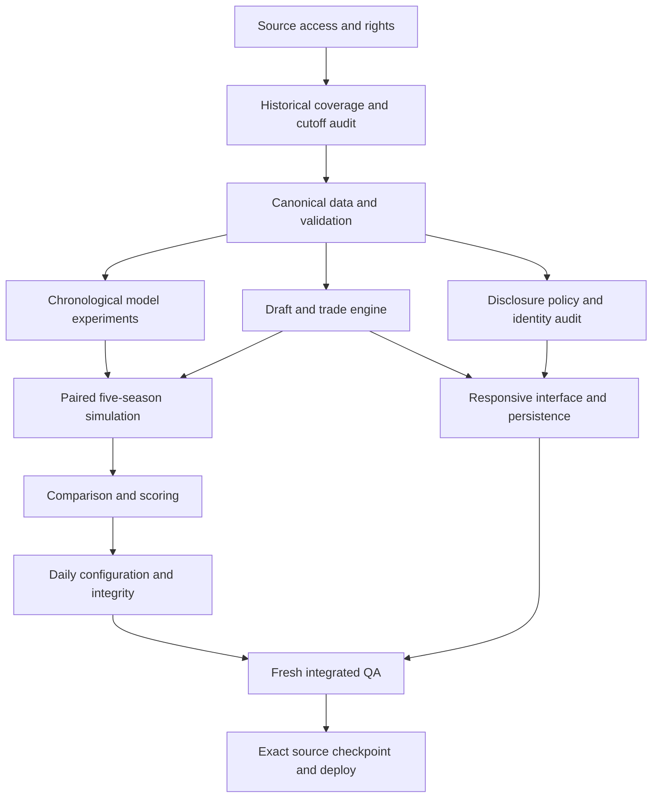

# Implementation plan and dependency graph

## Workstreams

Data owns acquisition, licenses, hashes, coverage and historical references. Modeling owns actual fitted artifacts, chronological experiments, predictions and diagnostics. Domain engineering owns pure draft/trade/simulation functions. Application engineering owns identity, server response sanitization, authorization, D1 persistence, revisions, idempotency and daily integrity. Frontend owns responsive interaction and state-driven charts. Architecture/QA owns schema design, independent tests, disclosure threat review and truthful acceptance records.

## Gates

1. Prove actual source access and permissible use; record missing data and revisions.
2. Validate IDs, missingness, units, initial ownership and point-in-time boundaries.
3. Fit baselines and candidates chronologically; match the claimed target to actual labels.
4. Complete all seven rounds with ownership conservation, uniqueness and legal selections.
5. Generate coherent league schedules/games/standings; align fitted and runtime models.
6. Keep actual, simulated baseline and alternate outputs separate; inspect convergence and model failures.
7. Implement server-filtered prospect disclosures and audit every cumulative scouting state.
8. Freeze daily data/model/engine/disclosure/scoring/ensemble configuration; reject incompatible replays.
9. Execute fresh domain, SQL, API, browser, visual, model and performance checks; report untested surfaces.
10. Commit/push source, build/package that exact state, verify deployment and preserve reproduction instructions.

## Production work beyond the alpha

Acquire a full prospect eligibility set and original publication evidence, exact April rosters/contracts, college production and injury/scouting data; validate five-year development and future personnel behavior; implement full scheduling/tiebreak/OT rules, future/conditional trades, broader CPU calibration, comprehensive security/load/accessibility tests and a human recognition study. Expanding years before these gates risks multiplying weak assumptions.

## November 12 integration status

The detailed execution plan and bounded workstream prompts are in `docs/release/PLAN_2026-11-12.md`. Recovery, GitHub repository setup, portable local play and 2018–2026 scenario routing are implemented. Every class passes the fixed all-team draft/league structural matrix. Release remains blocked on predictive adequacy, complete historical roster/scheme reconstruction, future individual personnel, full browser/device validation and production operations. Hosted Chromium/WebKit desktop/phone smoke tests now pass; retained receipts are linked from the current release report. The next research effort must acquire usable additional pre-cutoff QB trajectories and evaluate them; the official 2012 snap download still contains no rows. Repeating previously inspected statistical tests cannot replace new evidence.
