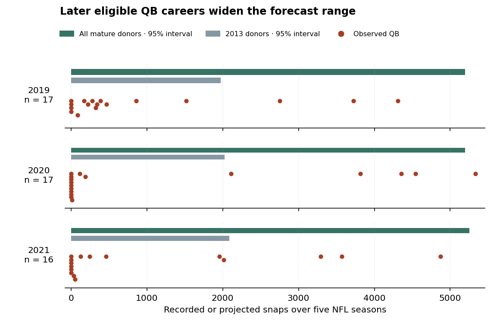

# Independent mature-QB donor review — 20 November 2026

The local data support more five-year QB evaluation, and later cutoff-safe donor pools materially improve upper-tail support. They do **not** supply an additional mature snap cohort for the strict 2018 forecast. The distinction matters: an effective later-origin forecast is not permission to give an earlier forecast future careers.

## Feasibility

Annual snap files from2013 through2025 reconcile exactly against recorded regular-season games. Cohorts through2021 therefore have complete five-season horizons. The2012 file remains header-only, so no pre2013 complete snap careers can be constructed. A2022 cohort requires2026 outcomes, which are not complete or locally available.

At the2018 cutoff, only2013 has finished five seasons;2014 only becomes eligible in March2019. Additional strict-pre2018 snap-tail evidence would require genuinely older records. Passing production or attempts cannot silently replace snaps. At later origins,2014–2016 careers provide valid extra evidence.

## Frozen candidate and comparison

PROTOCOL.md was written before loading this experiment’s cohort outcomes and is hashed in the result. One candidate was run: equal mass on whole QB careers from every cohort starting2013 and fully mature by the draft. Compare equal mass on2013 QB careers. No shrinkage, thresholds, tail noise, weights, or cohort choices are tuned. Both forecasts are unconditional within QB; this does not evaluate the production rookie-role probability conditioning. Normalize each donor annual value by that donor season’s scheduled games and multiply by target scheduled games. Actuals remain recorded integer snaps. Exact finite-mixture integration produces the metrics without Monte Carlo forecast approximation.

| Origin / cutoff UTC | Candidate cohorts / QBs | Assessment QBs | Assessment seasons | Latest fit label available | Full assessment label available |
|---|---|---:|---|---|---|
| 2019 / 2019-04-25 | 2013–2014 / 33 | 17 | 2019–2023 | 2019-03-01 | 2024-03-01 |
| 2020 / 2020-04-23 | 2013–2015 / 45 | 17 | 2020–2024 | 2020-03-01 | 2025-03-01 |
| 2021 / 2021-04-29 | 2013–2016 / 62 | 16 | 2021–2025 | 2021-03-01 | 2026-03-01 |

The baseline has15 QB careers throughout. Candidate maximum five-year snaps increases from approximately1975–2088 in the old pool to5199–5324, based on an actually completed Derek Carr career rather than artificial tail noise. The origin-specific schedule multipliers explain the different totals. A future-cohort poisoning check confirms no later cohort enters each candidate fit.

## Results

| Origin | Forecast | n | CRPS | MAE | RMSE | 95% covered / mean width | Outside support |
|---|---|---:|---:|---:|---:|---|---:|
| All | candidate | 50 | 800.14 | 1208.90 | 1647.67 | 49/50 / 5217.05 | 1 |
| All | baseline | 50 | 862.21 | 1086.20 | 1732.87 | 39/50 / 2028.61 | 11 |
| 2019 | candidate | 17 | 653.21 | 915.99 | 1344.69 | 17/17 / 5199.12 | 0 |
| 2019 | baseline | 17 | 689.65 | 820.81 | 1408.44 | 14/17 / 1975.25 | 3 |
| 2020 | candidate | 17 | 969.27 | 1467.76 | 1973.62 | 16/17 / 5199.12 | 1 |
| 2020 | baseline | 17 | 1055.45 | 1344.97 | 2065.45 | 12/17 / 2026.25 | 5 |
| 2021 | candidate | 16 | 776.55 | 1245.08 | 1556.91 | 16/16 / 5255.12 | 0 |
| 2021 | baseline | 16 | 840.24 | 1093.24 | 1656.36 | 13/16 / 2087.81 | 3 |

Across50 QBs, CRPS improves by62.07 snaps; the paired cohort-stratified player-bootstrap95% interval is[−115.85,−12.39] for candidate minus baseline, from5000 resamples. Each cohort’s point estimate also improves, but every cohort-specific interval crosses zero. This is evidence conditional on three empirical fits, not evidence of reliable improvement across eras.

95% coverage improves from39/50 to49/50 while mean width grows from2029 to5217. That wider interval reflects actual added career support. Its proper interval score improves from18305.86 to5324.15, so improvement is not judged by coverage alone. At80%, candidate covers41/50 versus36/50, with widths2606.53 versus1534.29; interval scores5817.56 versus6861.54. MAE worsens from1086.20 to1208.90 while RMSE improves from1732.87 to1647.67. A distributional improvement is not a universal point-prediction improvement.

## Adoption verdict

**Do not promote into production from this review.** Retain the rolling pooled-donor candidate as a justified research baseline for later scenarios. It addresses the tiny2013 pool’s missing upper tail using available completed careers, but cannot be used at the strict2018 origin. Its unconditional initialization does not establish personalized conditional calibration, causal draft value, or wins accuracy. No deployed model, review branch, gate, or threshold was changed.

The main research priority is now conditional calibration and parameter uncertainty for cutoff-specific pools, with a protocol fixed before new assessment—not more ad hoc tail inflation on reused2018 failures. The available data can expand later evaluation, but cannot manufacture an independent older five-year validation cohort.

## Limits and reproducibility

These historical target cohorts have appeared in related research; this is not a new untouched test. Combine participation and known-ID availability select the sample. Unknown identities are listed and excluded; known IDs absent from fully reconciled annual sources have zero recorded NFL snaps, not inferred retirement or injury. Database identities and source publication dates are retrospective; March1 label dates and pre-draft combine event availability are reconstructed. Bootstrap intervals condition on estimated donor distributions and omit refitting and between-era uncertainty.

Five checks pass: origin/cutoff and executed poisoning checks; complete source-game reconciliation and unique target count; metric/bootstrap reconstruction; unchanged actual totals; protocol/script/source hashes and no promotion. Exact annual-age metrics and all player predictions are saved. Run:

```bash
python qb_mature_donor_review.py --root /path/to/redraft --out /path/to/results
RD_ROOT=/path/to/redraft RD_QB_OUT=/path/to/results python test_qb_mature_donor_review.py
```

Keep PROTOCOL.md beside the script and results. All files are in `/tmp/rd2-qb-mature`; nothing was written to the repository or deployment.


