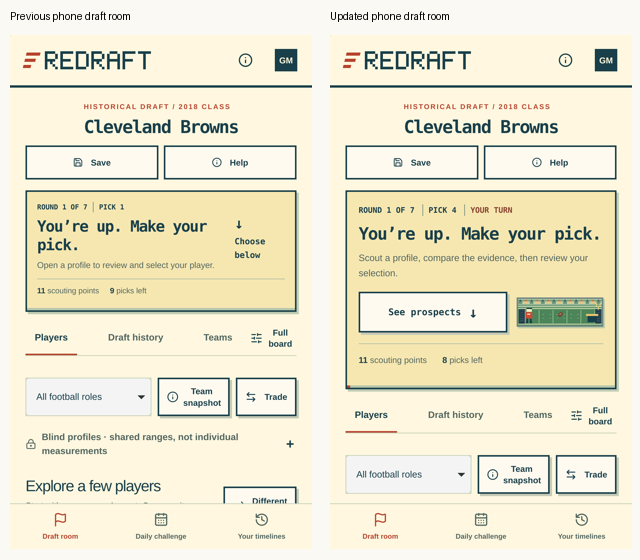

# Browser QA evidence — 2026-11-20

## Outcome

Browser verification is blocked in this execution environment. No browser journey completed, no current screenshots were captured, and no measured performance improvement is claimed. Syntax validation (`node --check tests/browser.mjs`) passes. This is not a browser pass.

| Engine | Attempt | Observed result |
| --- | --- | --- |
| Chromium | Playwright default executable | Browser binary absent (`chromium_headless_shell-1234`) |
| Chromium | System `/usr/bin/chromium`, headless | Launch aborts: `process_singleton_posix.cc:297`, `socket() failed: Operation not permitted (1)` |
| WebKit | Playwright default executable | Browser binary absent (`webkit-2336/pw_run.sh`) |

Machine-readable launch failures are retained in `tests/results/browser/chromium-report.json` and `webkit-report.json`. The Chromium start-server attempt reached the local API before failing browser launch. Later launch-only attempts isolate the infrastructure failure without requiring another server.

## Reproducible expanded journey

Run after initializing the local database using the repository's documented local setup:

```sh
npm run test:browser
REDRAFT_BROWSER=webkit npm run test:browser
```

An installed compatible Chromium can be selected explicitly:

```sh
REDRAFT_BROWSER_EXECUTABLE=/usr/bin/chromium npm run test:browser
```

`REDRAFT_BASE_URL` can target an already running local server when invoking `node tests/browser.mjs` without `--start-server`. The local identity flow requires `REDRAFT_LOCAL_IDENTITY=1` on that server. Never target a production instance: this test creates and saves drafts.

The suite creates a fresh isolated browser context per viewport, uses seeded 2018 Cleveland drafts, and sends real game requests. It covers desktop (1440×1000), iPhone 13 emulation, narrow phone (320×568), and tablet (768×1024). It exercises scouting, profile containment/focus/Escape, an actual confirmed user selection, CPU progression to the next user pick, and save/reload persistence of selection progress. It checks finished entry animation, horizontal overflow, and uncaught page errors.

Each successful viewport writes profile and draft screenshots plus elapsed journey time and reload navigation timings. Navigation timings are local development diagnostics, not production Core Web Vitals or a performance benchmark. Phone emulation is not physical-device validation. Trade negotiation and full seven-round completion are outside this journey.

## Before/after and remaining evidence

The pre-change smoke suite stopped after scouting/profile/save; it did not confirm a selection or advance CPU picks, and covered only desktop and iPhone emulation. The expanded suite adds those missing user actions and two viewport sizes. The old saved Chromium report already recorded a missing executable, so neither a valid visual baseline nor comparable before performance measurements exists.

Before release, run both engines in an environment with installed browsers, inspect all eight screenshot pairs, and record actual pass/failure results. Screen-reader use, physical touch devices, throttled mobile performance, and production deployment timings remain unverified.

## Hosted verification update

GitHub Actions run [44654963667](https://github.com/jviola1019/redraft/actions/runs/44654963667) passed the expanded Chromium and WebKit journeys at all four viewport configurations. Artifact 14592558825 was downloaded and its SHA-256 matched the GitHub digest. Both reports and the WebKit phone images are in visual/. An earlier WebKit phone screenshot was recovered from hosted artifact 13991388499. A screenshot comparison is now available.



On the phone the heading previously wrapped around a narrow action column. The new console gives instructions the full width and makes the pixel field visible. The console now occupies more vertical space, pushing the first prospect below the initial viewport. The screenshots are from different draft picks, so a pixel-difference percentage would conflate content and layout. These screenshots support a layout review. They do not measure novice comprehension or provide a maintained approved-image regression baseline.

The side-by-side review exposed two issues that a horizontal-overflow assertion missed. A feedback toast covered prospect details on phones and the visible console instruction required manually finding the board below the fold. The follow-up gives the console a real “See prospects” action with a focus target and visually clips notifications while a modal is open. Regression assertions exercise focus and confirm that an active notification cannot obscure the dialog. The hosted run for this revision is linked in CURRENT_RELEASE.md.

The follow-up [hosted run 44657304972](https://github.com/jviola1019/redraft/actions/runs/44657304972) passed all eight layout/scouting journeys and both complete mobile-viewport lifecycles. Artifact 14593718735 matched SHA-256 9ccdac640e7129590e18205ee233e33bf6b1ecca53e35bf54e85436ab04845e6. The phone comparison now shows the working “See prospects” action. The contact sheet preserves the earlier screenshot review that exposed the toast overlap.
