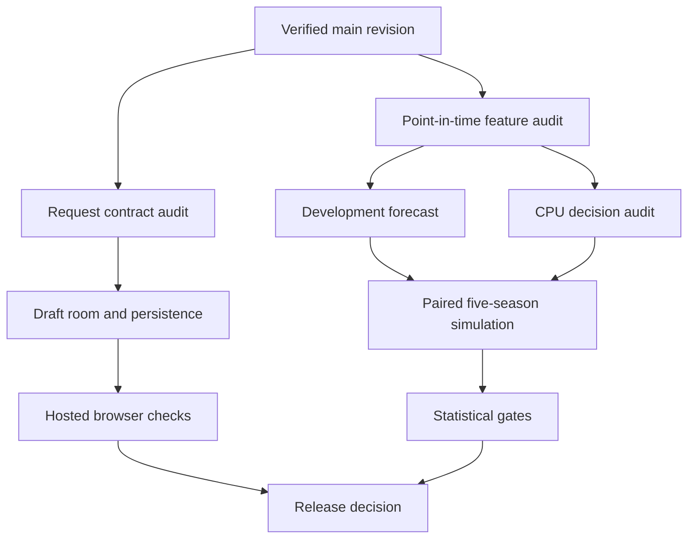

# Integration dependencies and rollback

The API persists versioned state in D1. Immutable challenge configuration binds runs to scenario, model, disclosure and engine versions. The clean data, modeling and simulation boundaries are documented in the root ARCHITECTURE.md and DATA_DICTIONARY.md. The full physical ERD and its relational constraints live under docs/erd and docs/warehouse. Revert subsystem commits on the review branch to roll back. No production database migration accompanies this revision.
